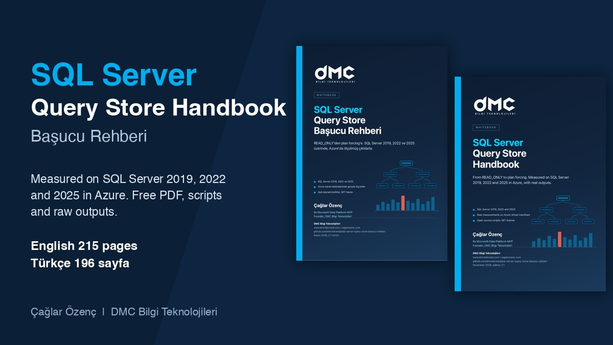

<p align="center">
  
</p>

# SQL Server Query Store Handbook, scripts and measurements

[Türkçe README](README.md)

[](LICENSE)
[](#measurement-matrix)
[](https://github.com/dmcteknoloji/sql-server-query-store-basucu-rehberi/releases/download/v2.1/DMC-SQL-Server-Query-Store-Handbook-v2.1.pdf)
[](https://github.com/dmcteknoloji/sql-server-query-store-basucu-rehberi/releases/download/v2.1/DMC-SQL-Server-Query-Store-Basucu-Rehberi-v2.1.pdf)

This repository holds the scripts and raw measurement outputs of the free **SQL Server Query Store Handbook** (215 pages in English, 196 in the Turkish original) by DMC Bilgi Teknolojileri. The handbook was written in Turkish first. The English edition is a translation of the same text, the same numbers and the same measurements. If you wonder how a measurement was taken, or you want to try a script on your own server, you can get it here.

The book was measured on SQL Server 2019, 2022 and 2025, on Windows Server virtual machines in Azure. Forced plan behavior, OPPO, automatic plan correction, the concurrent load test and the two node Availability Group experiments were run on SQL Server 2025 machines only. Automatic parameterization and PSP events were measured on SQL Server 2022 CU25 and 2025. What we did not measure (SQL Server 2016 and 2017, Linux, a clustered Availability Group, Standard edition, Azure SQL, individual cumulative updates) is stated in the book and here.

Both PDFs, Turkish and English, are in the [Releases](../../releases) section.

## Key findings

The numbers below come from the measurements in the book. The condition of each one is written next to it. Do not carry a number to another environment without knowing its condition.

| Finding | Condition | In the book |
|---|---|---|
| With a different literal value in every statement, capture mode `ALL` ran about 60 percent slower on an ad hoc workload, `AUTO` showed no difference | 8 concurrent sessions, SQL Server 2025, wide fluctuation between repeats (71.9 to 112.2 seconds) | Chapter 6 |
| PSP kicked in when the ratio of the highest to the lowest `EQUAL_ROWS` value in the histogram was 100,000, and did not at 99,999 | Single column equality predicate, SQL Server 2022 CU25 and 2025 RTM | Chapter 9 |
| On SQL Server 2025 RTM the `parameter_sensitive_plan_optimization` event did not fire, `multiplan_dispatcher_plan_compiled` and `multiplan_query_variant_plan_compiled` fired instead | Same lab, two version comparison | Chapter 9 |
| Only 5 of 24 queries were parameterized by simple parameterization, three queries with a trivial plan (`TOP`, `DISTINCT`, `IN` list) were not | SQL Server 2022 CU25 and 2025 RTM, same result | Chapter 9 |
| For every new query made persistent during a flush, about 5.3 transactions, 3 log flushes and 14 KB of log were written | 43,056 queries, 178 second flush, SQL Server 2025 RTM | Chapter 6 |
| Capture mode `AUTO` captured none of 300 one-off queries, `ALL` captured all 300. A query that ran 40 times was captured under `AUTO` as well | SQL Server 2019, 2022 and 2025, same result | Chapter 5 |
| A wrong plan caused by parameter sniffing was about 22 times slower for the big customer (737.71 ms against 33.23 ms for the scan plan). The same plan was about 365 times faster for the small customer | Table of 420 thousand rows, SQL Server 2025 | Chapter 8 |
| The Query Store queue from the secondary to the primary saturated at 25,000 messages and later messages were dropped permanently | 20,000 different queries from one session, two node Availability Group, `CLUSTER_TYPE = NONE` | Chapter 12 |
| Queries from a dynamic `EXEC` loop and direct queries reached the primary from the secondary in the same way | 8 execution styles, 2025 RTM | Chapter 12 |
| The `Success` state of automatic plan correction was not seen in any run, the move from `Verifying` to `Expired` silently removed the forced plan | SQL Server 2022 CU25 and 2025 RTM | Chapter 12 |

## What is in the book

The book has 20 chapters and can be read on its own. Every measured result sits in a green "DMC measurement" box. Statements that rest only on the documentation are marked "according to the documentation" in the text.

| Group | Chapters |
|---|---|
| Architecture and setup | 1 What Query Store is, 2 History and version differences, 3 Architecture and data model, 4 Enabling it, 5 Settings guide |
| Workload tuning | 6 Large databases, flush and quota, 7 Reports and reading with T-SQL, 8 Plan regression and plan forcing, 10 Query Store hints, 11 Wait stats |
| Internals and forensics | 9 Plan cache, PSP, OPPO and automatic parameterization, 14 Additional topics (why a forced plan cannot be applied, index maintenance, native procedure) |
| High availability and Availability Groups | 12 Automatic plan correction, compatibility level upgrade and secondary replicas, 13 Operations, maintenance and pre failover checks |
| Ready-made scripts and reference | 15 Pitfalls and troubleshooting, 16 Ready-made scripts, 17 Quick reference card, 18 Measurement scripts, 19 Glossary, 20 Sources and the limits of the measurement environment |

## Quick start

The starting configuration in Chapter 4 of the book is based on the examples in the Microsoft documentation, for SQL Server 2019 and later. It was run on three versions, but it is not a measured target for your workload. Try it in a test environment first, because `ALTER DATABASE ... SET QUERY_STORE` can clear the plan cache of that database.

```sql
ALTER DATABASE [YourDatabase]
SET QUERY_STORE = ON
(
  OPERATION_MODE              = READ_WRITE,
  CLEANUP_POLICY              = (STALE_QUERY_THRESHOLD_DAYS = 30),
  DATA_FLUSH_INTERVAL_SECONDS = 900,
  MAX_STORAGE_SIZE_MB         = 1000,
  INTERVAL_LENGTH_MINUTES     = 60,
  SIZE_BASED_CLEANUP_MODE     = AUTO,
  QUERY_CAPTURE_MODE          = AUTO,
  MAX_PLANS_PER_QUERY         = 200,
  WAIT_STATS_CAPTURE_MODE     = ON
);

-- Verify after turning it on, actual_state_desc should be READ_WRITE
SELECT actual_state_desc, readonly_reason, current_storage_size_mb, max_storage_size_mb
FROM sys.database_query_store_options;
```

## What is in the repository

Folder and file names are in Turkish, as in the Turkish edition. The table gives the meaning.

| Folder | Contents |
|---|---|
| `gorsel/` | Promotional images of the book. `paylasim/` holds social media sizes (1200x675 and the GitHub preview 1280x640). |
| `betikler/` | The T-SQL blocks of the book. The folder name is the chapter number. |
| `betikler/00-demo-veritabani.sql` | Creates the demo databases the sample outputs in the book were taken from. |
| `betikler/tum-bloklar.sql` | One file that runs all blocks in order. |
| `olcum/surum-karsilastirma/` | Experiments run on SQL Server 2019, 2022 and 2025, and the raw output of each version. |
| `olcum/forced-plan/` | Whether a forced plan was applied while Query Store was `READ_WRITE`, `READ_ONLY` and `OFF`, and the durations per plan and per parameter. |
| `olcum/kapatma-ve-read-only/` | Data loss with `OFF (FORCED)` and the behavior of Query Store procedures while `READ_ONLY`. |
| `olcum/psp-ve-oppo/` | PSP and OPPO experiments. |
| `olcum/psp-tetikleme/` | The PSP threshold, skip reasons, dispatcher and variant plans, hint name experiments. SQL Server 2022 CU25 and 2025 RTM. The README inside describes each experiment. |
| `olcum/flush-ve-disk/` | Flush and disk I/O measurement. Manual flush time for 60,000 different queries, a 150 second load with 4 sessions, disk counters and the polling query. |
| `olcum/tempdb-ve-replica/` | The `is_query_store_on` flag for `tempdb` (three versions, `model` and restart experiments) and the catalog objects for secondary replicas on SQL Server 2025. |
| `olcum/automatic-plan-correction/` | Finding a regression on its own and forcing the plan. |
| `olcum/eszamanli-yuk/` | Comparison of the `OFF`, `AUTO` and `ALL` modes with 8 concurrent sessions. |
| `olcum/temizleme-betigi/` | Trying the cleanup script for ad hoc and internal queries while `READ_ONLY`. |
| `olcum/ek-konular/` | Backup, restore, clone and Query Store memory measurements. |
| `olcum/bolum-18-dogrulama/` | Outputs of the Chapter 18 scripts, run a second time exactly as printed in the book. |
| `betikler/senaryolar/` and `betikler/senaryolar-en/` | T-SQL blocks of the measurement and monitoring scenarios of the book, with Turkish and English comments. Flush window, automatic parameterization, reading hints as a table, state transition alert, pre failover check, index maintenance, native procedure, Availability Group setup and the backpressure measurement. |
| `olcum/senaryolar/` | Raw measurement outputs of the same scenarios. The README inside says which file came from which version. |
| `olcum/ornek-cikti-kutulari-kaynagi.txt` | The raw output the "Sample output" boxes in the book were taken from. |

## Chapter 18 scenarios

Chapter 18 of the handbook has 14 measurement scenarios. The first six sit in their own folders under `olcum/`. The scripts of the later ones are under `betikler/senaryolar/` (Turkish comments) and `betikler/senaryolar-en/` (English comments), and their raw outputs are under `olcum/senaryolar/`. Both script folders have the same file names. The "Measured on" column says where the script was run, it does not promise that it runs on other versions.

| # | Scenario | Measured on | Needs | Script | Raw output |
|---|---|---|---|---|---|
| 1 | Forced plan, duration per parameter | 2025 | sysadmin, test server, a table of 420 thousand rows | `olcum/forced-plan/` | `olcum/forced-plan/` |
| 2 | Data loss with `OFF (FORCED)` | 2025 | sysadmin, creates and drops a database | `olcum/kapatma-ve-read-only/` | `olcum/kapatma-ve-read-only/` |
| 3 | Query Store procedures while `READ_ONLY` | 2025 | sysadmin | `olcum/kapatma-ve-read-only/` | `olcum/kapatma-ve-read-only/` |
| 4 | Concurrent load test | 2025 | `sqlcmd` or PowerShell able to open 8 concurrent connections | `olcum/eszamanli-yuk/` | `olcum/eszamanli-yuk/` |
| 5 | PSP trigger lab | 2022 CU25, 2025 | compatibility level 160 or higher | `olcum/psp-tetikleme/` | `olcum/psp-tetikleme/` |
| 6 | Flush and disk I/O measurement | 2025 | a separate data disk (`F:\data` in the script), sysadmin | `olcum/flush-ve-disk/` | `olcum/flush-ve-disk/` |
| 7 | Collecting PSP events by discovery | 2022 CU25, 2025 | sysadmin (server level Extended Events) | `betikler/senaryolar/bolum-18-psp-olaylarini-kesif-tabanli-toplamak/` | `olcum/senaryolar/psp-olaylari/` |
| 8 | Automatic parameterization measurement | 2022 CU25, 2025 | sysadmin, the database level `PARAMETERIZATION` setting changes | `betikler/senaryolar/bolum-18-otomatik-parametrelendirme-olcumu/` | `olcum/senaryolar/otomatik-parametrelendirme/` |
| 9 | Index maintenance and the forced plan | 2022 CU25, 2025 | sysadmin, Enterprise or Developer for `ONLINE` operations (the online case was not tested) | `betikler/senaryolar/bolum-18-index-bakimi-ve-sabitlenen-plan/` | `olcum/senaryolar/index-bakimi/` |
| 10 | Native procedure and statistics collection | 2022 CU25, 2025 | In-Memory OLTP, the script creates a `MEMORY_OPTIMIZED_DATA` filegroup | `betikler/senaryolar/bolum-18-native-procedure-ve-istatistik-toplama/` | `olcum/senaryolar/native-procedure/` |
| 11 | Flush window sampler | 2025 | sysadmin, about 1 GB free (in our run the log took 600 MB and Query Store 213 MB) | `betikler/senaryolar/bolum-18-flush-penceresi-ornekleyici/` | `olcum/senaryolar/flush-penceresi/` |
| 12 | Secondary replica validation and backpressure | 2025 RTM | two Windows Server machines, certificate authentication, `CLUSTER_TYPE = NONE`, HADR enabled, sysadmin | `betikler/senaryolar/bolum-18-secondary-replica-dogrulamasi-ve-geri-basinc/` | `olcum/senaryolar/ag-geri-basinc/` |
| 13 | Execution styles on the secondary | 2025 RTM | the Availability Group built in scenario 12, readable secondary | `betikler/senaryolar/bolum-18-secondary-de-calistirma-bicimleri/` | `olcum/senaryolar/ag-calistirma-bicimleri/` |
| 14 | Transaction and log counters during a flush | 2025 | sysadmin, about 1 GB free (in our run the log took 600 MB and Query Store 213 MB) | `betikler/senaryolar/bolum-18-flush-sirasinda-islem-ve-log-sayaclari/` | `olcum/senaryolar/flush-islem-sayaclari/` |

The alert, the capture procedure and the pre failover check scripts of Chapters 12 and 13 are also under `betikler/senaryolar/`. The first comment line of each script file says which chapter it came from.

## Before you run the scripts

- Try them in a test environment first. Many scripts create or drop databases or change Query Store settings.
- `ALTER DATABASE ... SET QUERY_STORE` commands can clear the plan cache of that database.
- The cleanup script deletes queries and the deleted data does not come back. It does not touch queries that have a forced plan or a hint.
- The Availability Group scripts were tried only on a two node group created with `CLUSTER_TYPE = NONE`. They were not tried on a clustered group or on servers with many databases. Replace the password in the certificate script with your own strong password.
- On SQL Server 2019, scripts that use objects specific to 2022 and later fail (hint views, `plan_type_desc`, `replica_group_id` and so on). The book marks these blocks.

## Known gaps

- The last section of `olcum/kapatma-ve-read-only/off-forced-ve-read-only.sql` fails, because it tries to force a plan on a query that has a hint. The clean result while `READ_ONLY` was taken in `read-only-prosedurleri.sql`. The book uses the result of that second file.
- The duration measurement section in `olcum/surum-karsilastirma/betikler/kapatma-yollari.sql` raised a syntax error. The scripts in `olcum/eszamanli-yuk/` were used for the load test.
- Lab database and variable names were moved to a standard after the first publication (`qs_lab_*`, `@plan_id_tarama` and so on). `olcum/bolum-18-dogrulama/ad-standardi-sonrasi/` holds the outputs taken with the new names, the other raw outputs contain the old names (`lc`, `lim_f`, `ov`, `psp_lab`, `flush_lab`). The mapping table is in the README of that folder.
- The `Success` state of automatic plan correction was not seen in any run. On a group without a cluster, `SET (ROLE = SECONDARY)` raised error 41104 and the failover was done with `FORCE_FAILOVER_ALLOW_DATA_LOSS`. Both are stated openly in the book.
- Server names (`vm-qs2019`, `vm-qs2022`, `vm-qs2025`) appear in the output files. They are temporary machines we set up for the measurements.

## Measurement matrix

| Topic | SQL Server 2019 | SQL Server 2022 CU25 | SQL Server 2025 RTM |
|---|---|---|---|
| Default settings, `model` inheritance, capture mode, plan cache | Measured | Measured | Measured |
| PSP, skip reasons, skew threshold | Not available (no PSP in this version) | Measured | Measured |
| Automatic parameterization, index maintenance, native procedure | Not measured | Measured | Measured |
| Forced plan life cycle, `OFF (FORCED)`, `READ_ONLY`, concurrent load | Not measured | Not measured | Measured |
| Flush, transaction and log counters | Not measured | Not measured | Measured |
| Automatic plan correction state transitions | Not measured | Measured | Measured |
| Two node Availability Group, secondary replica | Not measured | Not measured | Measured (`CLUSTER_TYPE = NONE`) |

Not measured are SQL Server 2016 and 2017, Linux, a clustered Availability Group, Standard edition, Azure SQL and individual cumulative updates.

| Version | Build | Edition | Machine |
|---|---|---|---|
| SQL Server 2019 | 15.0.4470.1 (CU32 and GDR) | Developer | Azure Standard D4s_v5, Windows Server 2022 |
| SQL Server 2022 | 16.0.4255.1 (CU25) | Developer | Azure Standard D4s_v5, Windows Server 2022 |
| SQL Server 2025 | 17.0.1000.7 (RTM) | Enterprise Developer | Azure Standard D8s_v5, Windows Server 2025 (two machines for the Availability Group) |

## License

Scripts and measurement outputs are shared under the MIT license, details are in `LICENSE`. When you use the scripts, keep the license text and the copyright line. The PDF of the book may be shared freely and unchanged, crediting the author and DMC Bilgi Teknolojileri. These terms are written in [`LICENSE-PDF.md`](LICENSE-PDF.md) and correspond to CC BY-ND 4.0. See [`CONTRIBUTING.md`](CONTRIBUTING.md) for contributions and `CITATION.cff` for citation. `python3 tools/kontrol.py` checks the paths in the repository and patterns of secrets.

## Citation

When you quote the book, credit the author and DMC Bilgi Teknolojileri.

```bibtex
@misc{ozenc2026querystore,
  author    = {Özenç, Çağlar},
  title     = {SQL Server Query Store Handbook},
  year      = {2026},
  publisher = {DMC Bilgi Teknolojileri},
  note      = {Edition 2.1, PDF, English translation of the Turkish original},
  url       = {https://github.com/dmcteknoloji/sql-server-query-store-basucu-rehberi}
}
```

APA style: Özenç, Ç. (2026). *SQL Server Query Store handbook* (Edition 2.1) [PDF]. DMC Bilgi Teknolojileri. https://github.com/dmcteknoloji/sql-server-query-store-basucu-rehberi

## Author

Çağlar Özenç, 6x Microsoft Data Platform MVP, founder of DMC Bilgi Teknolojileri. [caglarozenc.com](https://caglarozenc.com), [LinkedIn](https://www.linkedin.com/in/caglarozenc/), [dmcteknoloji.com](https://www.dmcteknoloji.com). For errors and gaps you can open an issue in this repository or write to iletisim@dmcteknoloji.com.
