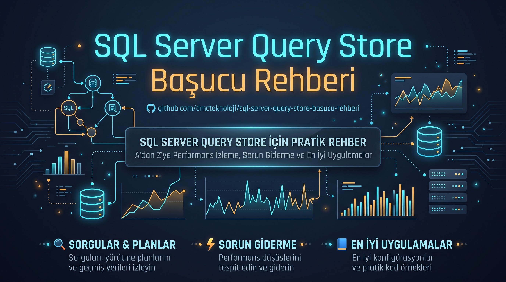
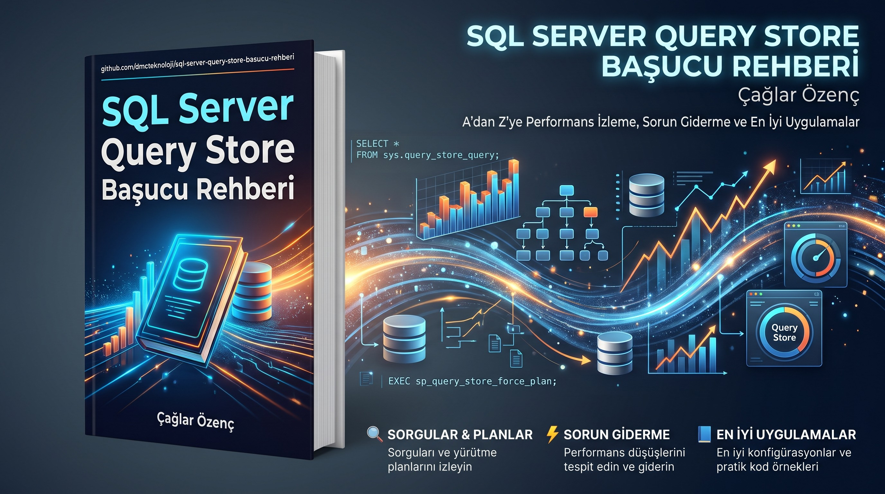

  

# SQL Server Query Store Başucu Rehberi, betikler ve ölçümler

  

Bu depo, DMC Bilgi Teknolojileri'nin ücretsiz **SQL Server Query Store Başucu Rehberi** kitabının betiklerini ve ham ölçüm çıktılarını içerir. Kitabı okurken bir ölçümün nasıl yapıldığını merak ederseniz ya da bir betiği kendi sunucunuzda denemek isterseniz buradan alabilirsiniz.

Kitap SQL Server 2019, 2022 ve 2025 üzerinde, Azure'daki Windows Server sanal makinelerinde ölçüldü. Forced plan davranışı, OPPO, automatic plan correction, eşzamanlı yük testi ve iki düğümlü Availability Group denemeleri yalnızca SQL Server 2025 makinelerinde, otomatik parametrelendirme ve PSP olayları SQL Server 2022 CU25 ile 2025'te ölçüldü. Ölçemediğimiz yerler (SQL Server 2016 ve 2017, Linux, cluster'lı Availability Group, Standard edition, Azure SQL, tek tek cumulative update'ler) kitapta ve burada açıkça belirtilir.

Kitabın PDF'i [Releases](../../releases) bölümündedir.

## Depoda neler var

| Klasör | İçeriği |
|---|---|
| `gorsel/` | Kitabın tanıtım görselleri. `paylasim/` altında sosyal medya boyutları var (1200x675 ve GitHub önizleme 1280x640). |
| `betikler/` | Kitaptaki T-SQL blokları. Klasör adı kitaptaki bölüm numarasıdır. |
| `betikler/00-demo-veritabani.sql` | Kitaptaki örnek çıktıların alındığı demo veritabanlarını kurar. |
| `betikler/tum-bloklar.sql` | Tüm blokları sırayla çalıştıran tek dosya. |
| `olcum/surum-karsilastirma/` | SQL Server 2019, 2022 ve 2025'te çalıştırılan deneyler ve her sürümün ham çıktısı. |
| `olcum/forced-plan/` | Sabitlenen planın Query Store `READ_WRITE`, `READ_ONLY` ve `OFF` durumlarında uygulanıp uygulanmadığı ve plan ile parametre başına süreler. |
| `olcum/kapatma-ve-read-only/` | `OFF (FORCED)` ile veri kaybı ve `READ_ONLY` iken Query Store prosedürlerinin davranışı. |
| `olcum/psp-ve-oppo/` | PSP ve OPPO denemeleri. |
| `olcum/psp-tetikleme/` | PSP'nin devreye girme eşiği, atlama nedenleri, dispatcher ve variant planlar, hint adı denemeleri. SQL Server 2022 CU25 ve 2025 RTM. İçindeki README dosyası her denemeyi anlatır. |
| `olcum/flush-ve-disk/` | Flush ve disk I/O ölçümü. 60.000 farklı query'nin elle flush süresi, 4 oturumla 150 saniyelik yük, disk sayaçları ve yoklama sorgusu. |
| `olcum/tempdb-ve-replica/` | `tempdb` için `is_query_store_on` bayrağı (üç sürüm, `model` ve yeniden başlatma denemeleri) ve SQL Server 2025'te secondary replica ile ilgili katalog nesneleri. |
| `olcum/automatic-plan-correction/` | Regression'ın kendiliğinden bulunup planın sabitlenmesi. |
| `olcum/eszamanli-yuk/` | 8 eşzamanlı oturumla `OFF`, `AUTO` ve `ALL` modlarının karşılaştırması. |
| `olcum/temizleme-betigi/` | Ad hoc ve iç query'leri temizleyen betiğin `READ_ONLY` iken denemesi. |
| `olcum/ek-konular/` | Yedek, restore, klon ve Query Store bellek ölçümleri. |
| `olcum/bolum-18-dogrulama/` | Kitaptaki Bölüm 18 betiklerinin, kitapta basıldığı haliyle ikinci kez çalıştırılmış çıktıları. |
| `betikler/ikinci-tur/` | Kitabın ikinci turunda eklenen bölümlerdeki T-SQL blokları: flush penceresi, otomatik parametrelendirme, hint'lerin tablo olarak okunması, durum geçişi alarmı, planlı failover öncesi kontrol, index bakımı, native procedure, Availability Group kurulumu ve geri basınç ölçümü. |
| `olcum/ikinci-tur/` | Aynı bölümlerin ham ölçüm çıktıları. Hangi dosyanın hangi sürümden geldiği klasördeki README dosyasındadır. |
| `olcum/ornek-cikti-kutulari-kaynagi.txt` | Kitaptaki "Örnek çıktı" kutularının alındığı ham çıktı. |

## Betikleri çalıştırmadan önce

- Önce test ortamında deneyin. Birçok betik veritabanı oluşturur, siler ya da Query Store ayarlarını değiştirir.
- `ALTER DATABASE ... SET QUERY_STORE` komutları o veritabanının plan cache'ini temizleyebilir.
- Temizleme betiği query'leri siler ve silinen veri geri gelmez. Sabitlenmiş planı ya da hint'i olan query'lere dokunmaz.
- Availability Group betikleri yalnızca `CLUSTER_TYPE = NONE` ile kurulmuş iki düğümlü bir group'ta denendi. Cluster'lı group'ta ve çok sayıda veritabanı olan sunucularda denenmedi. Sertifika betiğindeki parolayı kendi güçlü parolanızla değiştirin.
- SQL Server 2019'da 2022 ve sonrasına özgü nesneleri kullanan betikler hata verir (hint görünümleri, `plan_type_desc`, `replica_group_id` gibi). Kitapta bu bloklar işaretlidir.

## Bilinen eksikler

- `olcum/kapatma-ve-read-only/off-forced-ve-read-only.sql` dosyasının son bölümü, hint konmuş bir query'ye plan sabitlemeyi denediği için hata verir. `READ_ONLY` iken sonuç temiz olarak `read-only-prosedurleri.sql` dosyasında alındı. Kitap bu ikinci dosyanın sonucunu kullanır.
- `olcum/surum-karsilastirma/betikler/kapatma-yollari.sql` dosyasındaki süre ölçümü bölümü sözdizimi hatası verdi. Yük testi için `olcum/eszamanli-yuk/` klasöründeki betikler kullanıldı.
- Laboratuvar veritabanı ve değişken adları kitap yayınlandıktan sonra standarda çekildi (`qs_lab_*`, `@plan_id_tarama` gibi). `olcum/bolum-18-dogrulama/ad-standardi-sonrasi/` yeni adlarla alınan çıktıları, diğer ham çıktılar eski adları (`lc`, `lim_f`, `ov`, `psp_lab`, `flush_lab`) içerir. Eşleşme tablosu o klasördeki README dosyasındadır.
- Automatic plan correction'ın `Success` durumu hiçbir koşuda görülmedi. Cluster'sız group'ta `SET (ROLE = SECONDARY)` komutu 41104 hatası verdi, failover `FORCE_FAILOVER_ALLOW_DATA_LOSS` ile yapıldı. İkisi de kitapta açıkça yazılıdır.
- Çıktı dosyalarında sunucu adları (`vm-qs2019`, `vm-qs2022`, `vm-qs2025`) geçer. Bunlar ölçüm için kurduğumuz geçici makinelerdir.

## Ölçüm ortamı

| Sürüm | Build | Edition | Makine |
|---|---|---|---|
| SQL Server 2019 | 15.0.4470.1 (CU32 ve GDR) | Developer | Azure Standard D4s_v5, Windows Server 2022 |
| SQL Server 2022 | 16.0.4255.1 (CU25) | Developer | Azure Standard D4s_v5, Windows Server 2022 |
| SQL Server 2025 | 17.0.1000.7 (RTM) | Enterprise Developer | Azure Standard D8s_v5, Windows Server 2025 |

## Lisans

Betikler ve ölçüm çıktıları MIT lisansıyla paylaşılır, ayrıntı `LICENSE` dosyasındadır. Kitabın PDF'i yazarın adı ve DMC Bilgi Teknolojileri belirtilerek, değiştirilmeden serbestçe paylaşılabilir.

## Yazar

Çağlar Özenç, 6x Microsoft Data Platform MVP, DMC Bilgi Teknolojileri kurucusu. [caglarozenc.com](https://caglarozenc.com), [LinkedIn](https://www.linkedin.com/in/caglarozenc/), [dmcteknoloji.com](https://www.dmcteknoloji.com). Hata ve eksik için depoya issue açabilir ya da iletisim@dmcteknoloji.com adresine yazabilirsiniz.
